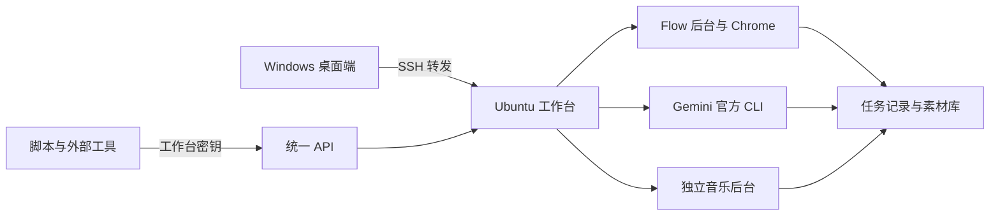

# 算力中心 StudioWright

StudioWright 把 **Flow 图片与视频生成、Gemini 对话与识图、音乐生成、素材管理**放在同一个工作台。创作者可以发任务、查进度、找原文件。已有脚本和工具也可以通过统一 API 提交任务和查询结果。

**Windows 负责操作，Ubuntu 负责执行和保存数据。** Windows 桌面端通过 SSH 连接 Ubuntu，支持局域网发现和系统托盘。任务、账号状态、项目和素材由 Ubuntu 上的服务管理。

[下载 v1.0.1](https://github.com/xx2xiao02-ship-it/studiowright-creative-workbench/releases/tag/v1.0.1) · [安装说明](docs/安装说明.md) · [API 文档](docs/API.md) · [版本记录](CHANGELOG.md)

## 可以做什么

| 功能 | 用法 |
| --- | --- |
| **Flow 图片与视频** | 用提示词生成图片或视频，可带参考素材。自动派发会选择可用账号，并复用或创建该账号的工作项目。可以回查原任务、失败原因和生成文件。 |
| **Gemini 对话与识图** | 通过 Ubuntu 上的 Google Antigravity CLI 调用。支持文字对话、推理和图片分析。可用型号与思考等级取决于账号授权和额度，同一对话沿用实际分配的账号与模型。 |
| **音乐生成** | 通过单独部署的音乐后台，按提示词生成音频，查看进度并取回结果。成功入库后可按风格、情绪、乐器等标签筛选。 |
| **素材库** | 管理图片、视频和音频，保留来源及任务编号，支持预览、检索、标签和原文件下载。图片和视频可交给 Gemini 补充内容标签或镜头说明。 |
| **账号池与任务记录** | 分开管理 Flow 和 Gemini 账号，查看登录、就绪状态和额度。Flow 账号移除后仍可查询历史任务。刷新、断线或结果待确认时，可沿用原编号继续查询。 |
| **统一 API** | 一套工作台密钥用于对话、识图、Flow 生成、音乐和素材查询。已提交的任务可以按原请求编号查询、下载或核对结果。 |

## 下载与开始使用

| 安装包 | 下载与要求 |
| --- | --- |
| **Ubuntu 全量服务端** | [下载 Ubuntu 24.04 安装包](https://github.com/xx2xiao02-ship-it/studiowright-creative-workbench/releases/download/v1.0.1/StudioWright-Ubuntu-24.04-Setup-1.0.1.run)。使用 Ubuntu 24.04 桌面版（x86-64、GNOME 46），提前安装 Chrome。 |
| **Windows 全量操作端** | [下载 Windows 安装包](https://github.com/xx2xiao02-ship-it/studiowright-creative-workbench/releases/download/v1.0.1/StudioWright-Windows-Desktop-Setup-v1.0.1.exe)。使用 Windows x64，需要 WebView2 Runtime，嵌入式 Python 已随包提供。 |
| **SHA-256 校验** | [下载校验文件](https://github.com/xx2xiao02-ship-it/studiowright-creative-workbench/releases/download/v1.0.1/SHA256SUMS.txt)。校验值用于检查安装包下载是否完整。 |

1. **先准备 Ubuntu。** 新机器以普通桌面用户运行 Ubuntu 安装包，先用 `--mode system-deps` 准备系统依赖，再用 `--mode new` 安装服务。已有工作台可用 `--mode reuse` 继续使用原服务和数据。要把已有服务升级到 1.0，请按手册分组更新并准备回退。[Ubuntu 安装与升级](docs/DEPLOYMENT.md)
2. **再连接 Windows。** 安装桌面端后打开「连接 Ubuntu 工作台」，选择局域网发现的主机或手动输入地址。首次连接时向管理员核对 SSH 主机指纹。密码仅供当前会话使用。[Windows 连接与账号助手](docs/DEPLOYMENT.md#3-windows-操作端)
3. **按需接入服务。** Flow 需要在 Ubuntu 的对应 Chrome 用户中登录 Google 并核对固定任务页。Gemini 需安装官方 CLI 并逐账号授权。使用音乐生成功能时，需要单独接入音乐后台。[接入 Flow、Gemini 与音乐](docs/DEPLOYMENT.md#4-接入账号gemini-与音乐)
4. **核对就绪状态。** 在工作台总览查看对应服务，确认登录、账号、项目和额度，再创建任务。Ubuntu 1.0 安装包提供 `--mode input-setup` 和 `--mode input-check`，用于配置和验证可选的虚拟键鼠输入。[硬件输入与验收](docs/DEPLOYMENT.md#全新安装)

## 系统如何运行

工作台页面使用本机端口 `18920`，统一 API 使用 `18922`，Flow 后台使用 `18888`。从 Windows 连接时通过桌面端或 SSH 转发访问。[完整拓扑](docs/WORKFLOW.md)

开发者可以先向 `http://127.0.0.1:18922/health` 发起 GET 请求检查 API 是否可达，再从工作台的「API 文档」页创建调用密钥。提交任务时保存 UUID，超时或结果待确认时用原编号查询，以免重复生成。[API 请求示例、模型选择与下载方法](docs/API.md)

## 安装前需要知道

- 全量安装包包含 StudioWright 的操作端或基础服务。Google 登录授权、官方 Gemini CLI、独立音乐后台需按部署环境接入。
- 账号资料、密钥、浏览器会话、历史任务和素材保存在运行环境。迁移时需备份并按部署手册处理。
- Google 账号验证、模型授权、额度和实际可用情况由上游服务决定。遇到登录或验证提示，请在相应账号窗口处理，再回工作台检查。[自动恢复说明](docs/AUTO_RECOVERY.md)

## 源码与维护

| 目录 | 内容 |
| --- | --- |
| [`packaging/windows`](packaging/windows) | Windows 桌面程序、账号助手、安装器与构建脚本 |
| [`packaging/ubuntu/snapshot/workbench`](packaging/ubuntu/snapshot/workbench) | Ubuntu 工作台、统一 API、Gemini、音乐与素材分析 |
| [`packaging/ubuntu/snapshot/flow`](packaging/ubuntu/snapshot/flow) | Flow 控制台、`sw` 执行器、任务与素材库 |
| [`packaging/ubuntu`](packaging/ubuntu) | Ubuntu 服务端安装、快照校验、硬件输入与分组升级 |
| [`packaging/music`](packaging/music) 和 [`tests`](tests) | 音乐后台维护工具与项目回归测试 |

Windows 构建入口为 `packaging/windows/build_client.py`，需要 .NET 编译器、嵌入式 Python 和 WebView2 SDK。Ubuntu 构建入口为 `packaging/ubuntu/build_server.py`，需要锁定的离线 Python 依赖，构建前会校验源码快照。[构建说明](docs/DEPLOYMENT.md#6-从源码构建安装包) · [代码地图](docs/CODEBASE.md)

项目包含第三方组件，各组件的许可随源码或打包文件提供。[Flow 源码许可证](packaging/ubuntu/snapshot/flow/source/LICENSE)
