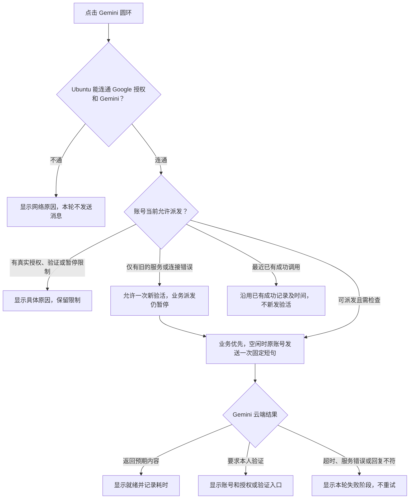

# Gemini 一键就绪

点击总览的 Gemini 圆环，检查当前可派发账号的云端响应。没有账号级故障且最近 30 分钟已有成功调用的账号，保留原记录及时间，不再新发验活。其余账号发送一次固定短句；不重试、不换号，回复、耗时和失败原因记在「Gemini 云端验活」对话下。复用记录不冒充本轮新测试。

验活在普通业务之后排队；有文字或识图业务等待、执行时不开始新的验活。验活最多同时执行一条，不占用 Flow 名额。Gemini CLI 默认总并发 50，可在操作台调整，文字、识图和素材分析共用；同账号独立对话可同时执行，同一对话逐轮执行。已经运行的验活自然结束，不强行中断。

首次授权时，从「Gemini 一键就绪」在 Ubuntu 的对应 Chrome 窗口打开 Google 授权页。已经核对过 Flow 登录的账号可以使用自己的 Chrome 窗口办理授权，无需先建 Flow 项目。遇到 Google 登录确认或验证时，在 Ubuntu 完成提示。

## 消息执行中的自救

- 明确未发送且遇到临时启动故障：原账号重试一次。
- 确认未发送且 CLI 提示登录：先用原账号的已保存授权尝试恢复；通过后最多补发一次。只有要求本人授权时才提示。两条路径共享一次补发机会。
- 明确结束但仅返回已识别的通用拒答，或有明确的空回复、截断证据：用原账号重试一次。两次结果记在同一条消息下。普通事实错误不能靠关键词自动判定。
- 流式回复仍在接收时继续等待。连接中断或结果未确认时保留已收到的内容；对话后台独立找回已落盘的完整文字回复，未找到完整凭据时不重发。这个步骤不属于一键就绪。
- 正常请求不需要浏览器常驻。本人授权或验证时按界面提示操作。Flow 的生成任务独立调度。
- Gemini 服务复用 Ubuntu 已配置的本机代理。网络检查不带账号凭据，不发送模型消息，也不消耗模型额度。
- 只有收到正确的云端验活回复后才解除该账号原有的服务错误限制。旧消息保留；若本轮仍失败，限制也保留。
- 云端短句只验当前账号能否正常回答；历史回复或剩余额度不能代替本轮云端响应。
