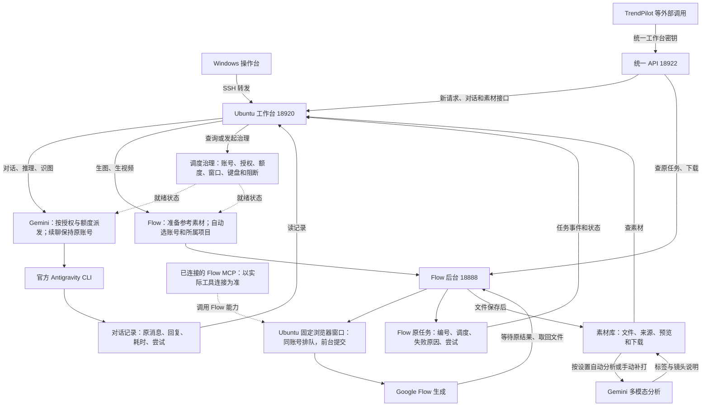
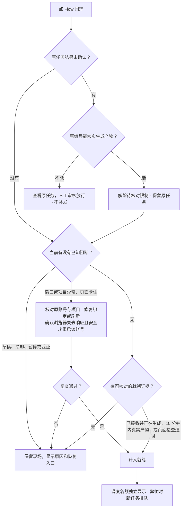
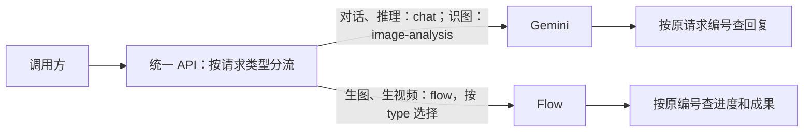
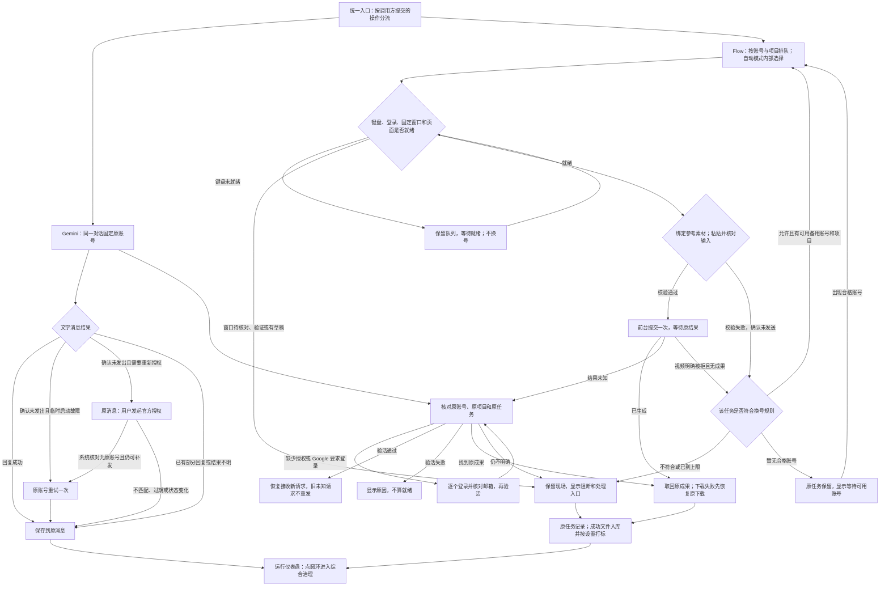

# StudioWright 创作工作台 · 全项目运行拓扑

[打开全尺寸总图](WORKFLOW.svg) · [对外 API](API.md) · [Windows / Ubuntu 安装](安装说明.md)

## 1. 从入口到结果

| 入口 | 实际路径 | 返回什么 |
| --- | --- | --- |
| Windows 操作台 | 局域网发现或手填 Ubuntu 地址 → SSH 转发 → 工作台（18920） | 总览、账号、项目、任务、对话和素材。任务页订阅更新；账户治理另有记录。 |
| TrendPilot 等外部调用 | 工作台统一密钥 → 统一 API（18922）→ 工作台接收推理、识图、生成与上传；Flow 原任务查询和文件下载可直接转发到 Flow 后台（18888） | 按接口返回回复或请求编号。后续查询和下载使用原编号。 |
| 已连接的 Flow 工具 | Flow MCP 工具进入同一套 Flow 能力。实际连到哪个实例以工具连接为准。 | Flow 任务及可取回的文件。 |

- **两条主线。** Gemini 执行推理、对话和识图；Flow 执行图片和视频生成。素材标签由 Gemini 多模态分析写回，成果文件继续留在素材库。
- **Flow 项目由内部安排。** 自动模式选择可用账号，优先复用该账号的 `FLOW+邮箱名` 项目，没有时创建。参考素材先保存，再绑定到实际执行账号和项目；换号时按新项目重新绑定。前台窗口用于提交，等待结果与提交分开；如果恢复取回需要重连原页面，仍查原任务。
- **调度治理单独记录。** 授权、账号同步、窗口检查和恢复进调度记录。业务任务保留原编号，下面记录每次尝试。界面的就绪表示没有已知阻断，实际提交前仍需复核。
- **部署边界。** Windows 是操作端；Ubuntu 执行和保存数据。Ubuntu 可以复用现有服务。全新安装需接入 Flow 桌面与账号、安装官方 CLI 并完成授权；安装包不含现有凭据、素材和历史。

### Flow 仪表盘：一键就绪

- 用户可以点一键就绪发起检查。Ubuntu 工作台也会定时检查可安全恢复的空闲 Flow 页面，维修模式、运行任务和账号冷却会限制自动恢复。修复优先复用已核对的原账号窗口和项目。遇到草稿、需要用户登录或无法确认项目时，保留现场并显示原因。修复过程保护原任务及草稿。
- 待审核放行只解除对应账号与原任务的阻断，原编号和原结果保持。近期成功以实际产物为准，不用排队或开始执行记录代替。

## 2. 统一 API 请求分流

工作台根据接口和请求参数确定路线。正文和附件交给选定路线处理；工作台不会根据正文改派，也不会自动调用另一条路线。

## 3. 运行与恢复

- **Gemini**：只有能确认未发送时才走对应补发路径，合计最多一次；不换号。授权、回复和失败原因留在原消息。
- **Flow**：仅符合规则的单图、单视频可换号，最多三次。确认未发出才可重试图片；视频还可在明确被拒且无成果后进入判断。参考素材在新账号的项目重新绑定；对外始终查原任务编号。结果不明不重发。
- **综合治理**：圆环按最新已核对的就绪账号计数。打开只读取状态；授权和检查需明确点击。就绪表示当前没有已知派发阻断，提交前仍会复核。
